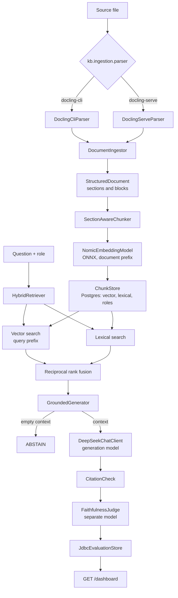

# Enterprise Knowledge Assistant

Quarkus service that turns policy documents into grounded answers. Parsing, chunking, and embedding stay local. Generation and judging call DeepSeek. Postgres holds the chunks, the vector index, lexical search, and evaluation runs.

Java 21. Module: `enterprise-kb-assistant`.

## Run

```bash
cd enterprise-kb-assistant
mvn quarkus:dev
```

Needs Postgres (`kb` / `kb` on `localhost:5432` by default), `DEEPSEEK_API_KEY`, and the `docling` CLI when `kb.ingestion.parser` is `docling-cli`. Configuration lives in `src/main/resources/application.yaml`. Quarkus does not load YAML unless `quarkus-config-yaml` is on the classpath; that dependency is already in the module POM.

The only HTTP surface today is `GET /dashboard`, which renders stored evaluation runs.

## Control flow

Documents are ingested offline. A question then goes through retrieval, generation, and an independent judge. Evaluation rows land in Postgres and show up on the dashboard.



### Ingest

`ParserSelection` reads `kb.ingestion.parser` and picks `DoclingCliParser` (subprocess) or `DoclingServeParser` (HTTP). `DocumentIngestor` keeps the structured document, the parser name, and a SHA-256 of the source bytes.

`SectionAwareChunker` walks sections. Tables stay whole. Each chunk keeps the heading path and the roles allowed to see it. `NomicEmbeddingModel` embeds with the document prefix and stores the vector through `ChunkStore`.

### Ask

`HybridRetriever` embeds the question with the query prefix and runs vector search and lexical search in parallel, both already filtered by role in SQL. `ReciprocalRankFusion` merges the two rankings by position. The candidate list is larger than the final cut so a later reranker has room to reorder.

`GroundedGenerator` refuses to call the model when the context is empty and returns `ABSTAIN`. Otherwise it asks DeepSeek to answer only from the numbered chunks and to cite them as `[1]`. `CitationCheck` checks that every citation points at a chunk that was actually retrieved.

### Judge and dashboard

`FaithfulnessJudge` sends the question, the answer, and the same context to a different DeepSeek model. Abstentions are not graded. The judge returns claim verdicts plus relevancy and completeness. `JdbcEvaluationStore` persists runs. `DashboardResource` reads them and renders citation validity, abstain rate, faithfulness, and recall against faithfulness.
